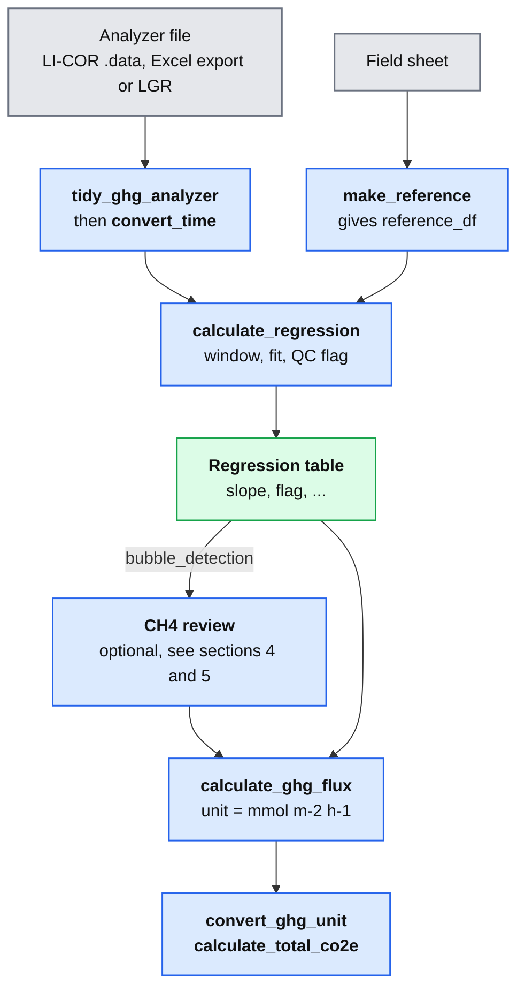
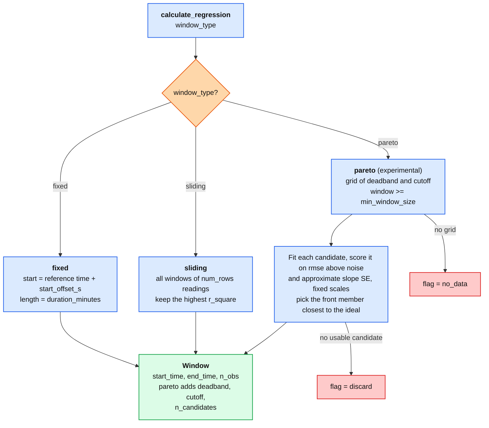
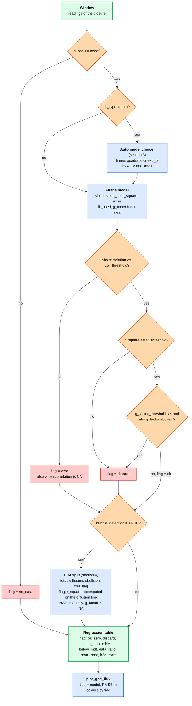
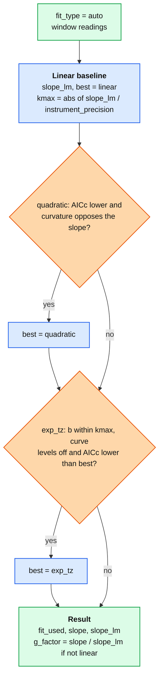
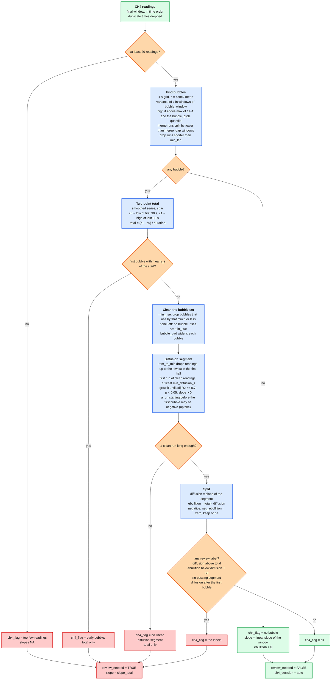
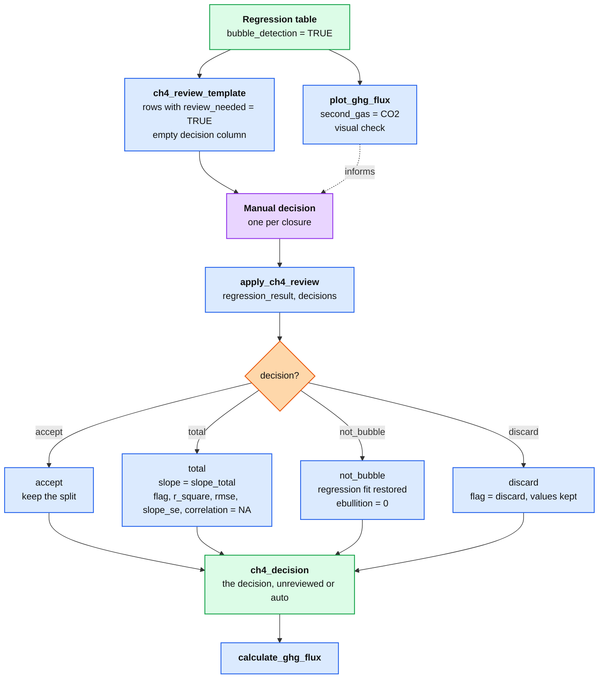

# Overview

**aelab** is an R package for aquatic ecology data analysis. It provides tools for:

1. **GHG flux calculation** — process raw data from LI-COR and LGR gas analyzers, calculate chamber flux, convert units, compute Minimum Detectable Flux (MDF), and aggregate to CO₂-equivalents.
2. **Net ecosystem metabolism (NEM)** — calculate gross primary production (GPP), ecosystem respiration (ER), and net ecosystem production (NEP) from high-frequency dissolved oxygen data.
3. **Statistical analysis** — descriptive statistics, outlier detection, normality testing, data transformation, one-way ANOVA (Tukey HSD), and Kruskal-Wallis (Dunn post-hoc) with compact letter display.
4. **Visualization** — ggplot2-based plot wrappers (point, line, box, bar) with a consistent theme and custom colour palettes.
5. **Gantt-style progress tables** — `gantt_table()` renders a coloured `flextable` (PDF/DOCX/PPTX-compatible) where columns are sampling campaigns and rows are measurement categories × systems; `gantt_text()` renders the same data as Unicode text for terminal/Neovim viewing.

## GHG Flux — What's New (v1.1.5)

`calculate_regression()` has been substantially extended:

- **`fit_type = "auto"`** — automatic model selection per measurement window: tries linear → quadratic → `exp_tz` in order, accepting a more complex model only when its AICc is lower (Kutzbach et al. 2007), a quadratic only when it levels off rather than accelerates (Levy et al. 2011), and the exponential fit only when its curvature κ does not exceed `kappamax`. The model chosen is recorded in the new `fit_used` output column.
- **`window_type = "fixed"` + `start_offset_s`** — regresses a single fixed window starting at a user-specified dead-bar offset (e.g. 30 s) after the reference time. Ensures all gases are regressed over the same time period. The default `"sliding"` window remains available for backward compatibility.
- **Per-row window overrides** — `reference_df` may include optional `duration_minutes` and/or `start_offset_s` columns. When a row has a non-`NA` value, it overrides the global parameter for that measurement. Useful when individual closures have different deployment lengths or early-saturation artefacts.
- **`kappamax`** — caps exponential curvature at a physically plausible maximum. When `fit_type = "auto"`, `kappamax` is computed automatically per window from the instrument precision (κmax = |linear slope| ÷ instrument 1σ precision; Hüppi et al. 2018).
- **`analyzer_precision` dataset** — built-in lookup table of 1-second precision values (1σ, in each analyzer's reporting unit: ppb for LI-COR CH₄/N₂O, otherwise ppm) for LI-7810 (CH₄, CO₂) and LI-7820 (N₂O). `tidy_ghg_analyzer()` adds them to LI-COR data as `<gas>_prec` columns, which `fit_type = "auto"` and `window_type = "pareto"` use.
- **`fit_used` column** — new output column recording which model was actually selected (`"linear"`, `"quadratic"`, or `"exp_tz"`). Always matches `fit_type` unless `fit_type = "auto"`.

`make_reference()` builds a `reference_df` for `calculate_regression()` from a compact multiline string of field notes — one closure per line: `time  site  analyzer  [dur=N]  [off=N]`. Optionally writes the result to `.xlsx`.

`window_type = "pareto"` (experimental) searches deadband (start skip) and cutoff (window end) times per closure and scores each candidate on `rmse` and an approximate slope standard error (`instrument_precision / sqrt(Sxx)`), then picks the front member closest to the ideal corner. The deadband x cutoff search, Pareto front and closest-to-ideal pick follow Kobayashi et al. (2026); the two scores and their fixed scaling (rmse above the noise level in units of `instrument_precision`; slope SE relative to that of all readings, so the pick does not change with `cutoff_step`) are aelab's own (like the paper, the uncertainty uses the sensor precision, not the residuals). `instrument_precision` is required. The `kappamax` gate and the `zero`/`discard` flags always apply, and no uncertainty interval is reported. New output columns: `deadband`, `cutoff`, `n_candidates`.

## References

- Yong, Z.-J., Lin, W.-J., Lin, C.-W., & Lin, H.-J. (2024). Tidal influence on carbon dioxide and methane fluxes from tree stems and soils in mangrove forests. *Biogeosciences*, 21(22), 5247–5260. https://doi.org/10.5194/bg-21-5247-2024
- Staehr, P. A., Bade, D., Van de Bogert, M. C., Koch, G. R., Williamson, C., Hanson, P., Cole, J. J., & Kratz, T. (2010). Lake metabolism and the diel oxygen technique: State of the science. *Limnology and Oceanography: Methods*, 8(11), 628–644. https://doi.org/10.4319/lom.2010.8.0628
- Hutchinson, G. L., & Mosier, A. R. (1981). Improved soil cover method for field measurement of nitrous oxide fluxes. *Soil Science Society of America Journal*, 45(2), 311–316. https://doi.org/10.2136/sssaj1981.03615995004500020017x
- Hüppi, R., Felber, R., Krauss, M., Six, J., Leifeld, J., & Fuß, R. (2018). Restricting the nonlinearity parameter in soil greenhouse gas flux calculations for more reliable flux estimates. *PLOS ONE*, 13(7), e0200876. https://doi.org/10.1371/journal.pone.0200876
- Gaudard, J., Telford, R. J., Chacon-Labella, J., Dawson, H. R., Enquist, B. J., Töpper, J. P., Trepel, J., Vandvik, V., Baumane, M., Birkeli, K., Holle, M. J. M., Hupp, J. R., Santos-Andrade, P. E., Satriawan, T. W., & Halbritter, A. H. (2025). fluxible: An R package to process ecosystem gas fluxes from closed-loop chambers in an automated and reproducible way. *Methods in Ecology and Evolution*, 16(11), 2560–2568. https://doi.org/10.1111/2041-210X.70161
- Kobayashi, A. N. A., Roques, C., Hunkeler, D., & Brunner, P. (2026). Uncertainty quantification in soil gas fluxes: Reducing the user's arbitrariness. *European Journal of Soil Science*, 77, e70415. https://doi.org/10.1111/ejss.70415
- Jeffrey, S. W., & Humphrey, G. F. (1975). New spectrophotometric equations for determining chlorophylls a, b, c1 and c2 in higher plants, algae and natural phytoplankton. *Biochemie und Physiologie der Pflanzen*, 167(2), 191–194. https://doi.org/10.1016/S0015-3796(17)30778-3

# Installation

The `aelab` package can be installed from:

1. GitHub (development version):

```r
# install.packages("devtools")
devtools::install_github("Zhao-Jun-Yong/aelab")
```

2. CRAN (stable version):

```r
install.packages("aelab")
```

# Features

For a full walkthrough with worked examples and code output, see the package vignette:

```r
vignette("aelab")
```

# GHG chamber-flux workflow

## Overview



## 1 Window selection



| Setting | Default |
|---|---|
| `window_type` | `"fixed"` |
| `start_offset_s`, `duration_minutes` | 0 s, 7 min (`duration_minutes` can also be a `reference_df` column) |
| `num_rows` (sliding) | 300 readings |
| `min_deadband`, `max_deadband`, `deadband_step` | 30, 60, 10 s (grid 30 to 50 s) |
| `min_window_size`, `cutoff_step` | 60 s, 10 s (cutoffs from 90 s to the last reading) |
| `instrument_precision` | none: needed for `fit_type = "auto"`; falls back to the single value in the `<gas>_prec` column that `tidy_ghg_analyzer()` adds |

## 2 Fit and QC



| Setting | Default |
|---|---|
| `fit_type` | `"linear"` |
| `min_obs` | 60; `need = max(min_obs, parameters of the model + 1)`. Sliding stops with an error if `num_rows < need`; pareto applies the floor to each candidate |
| `cor_threshold`, `r2_threshold` | 0.5, 0.7 |
| `g_factor_threshold` | `NULL` (off); applied before the CH4 split, so a split closure no longer carries it |
| `kappamax`, `t_zero` | `NULL`, 0 |
| `bubble_detection` | `FALSE` |

Flagged rows stay in the table and `calculate_ghg_flux()` does not filter on `flag`.

## 3 Auto model choice (`fit_type = "auto"`)



AICc = n ln(RSS / n) + 2k + 2k(k + 1) / (n - k - 1), with k the fitted parameters plus 1 (Kutzbach et al. 2007; Leiber-Sauheitl et al. 2014). `kmax` follows Hüppi et al. 2018. A curve that bends the same way as the slope is rejected (Levy et al. 2011). `g_factor_threshold` is described in section 2.

## 4 CH4 bubble detection



| `ch4_options` | Default |
|---|---|
| `bubble_window`, `bubble_align` | 10 s, `"centre"` |
| `bubble_prob`, `merge_gap`, `min_len` | 0.75, 10 s, 5 s |
| `early_s`, `early_from` | 20 s, `"window"` |
| `total_from`, `spar`, `nknots_ratio` | `"window"`, 0.5, 1/3 |
| `trim_to_min`, `neg_ebullition` | `TRUE`, `"zero"` |
| `min_rise`, `bubble_pad`, `min_diffusion_s` | 0 (off), 0, 20 s |

Fixed in the code, not options: variance floor 1e-4, at least 20 readings, adj R2 0.7 and p 0.05 for the diffusion segment (slope must be positive, except in a run that starts before the first bubble), 30 s edges for the total, 10 s block gap. Sources are in the code comments (Minaudo et al. 2026; So et al. 2024).

## 5 CH4 bubble review (optional)



Closures without `review_needed` get `ch4_decision = "auto"`; those with it and no decision get `"unreviewed"`, and `calculate_ghg_flux()` warns.
